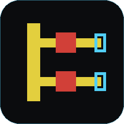
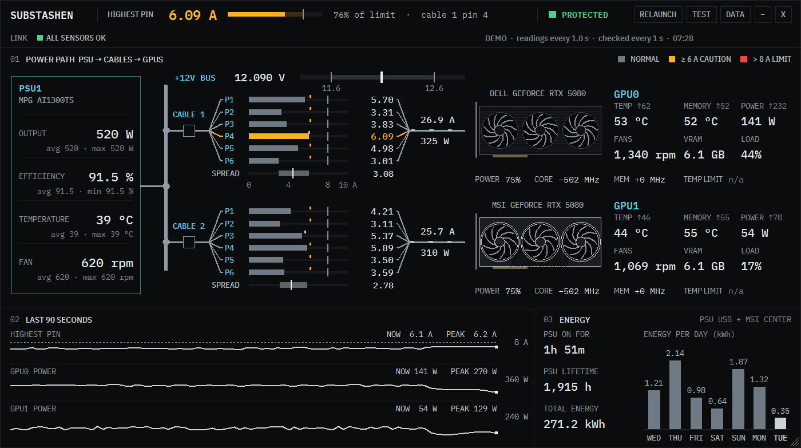
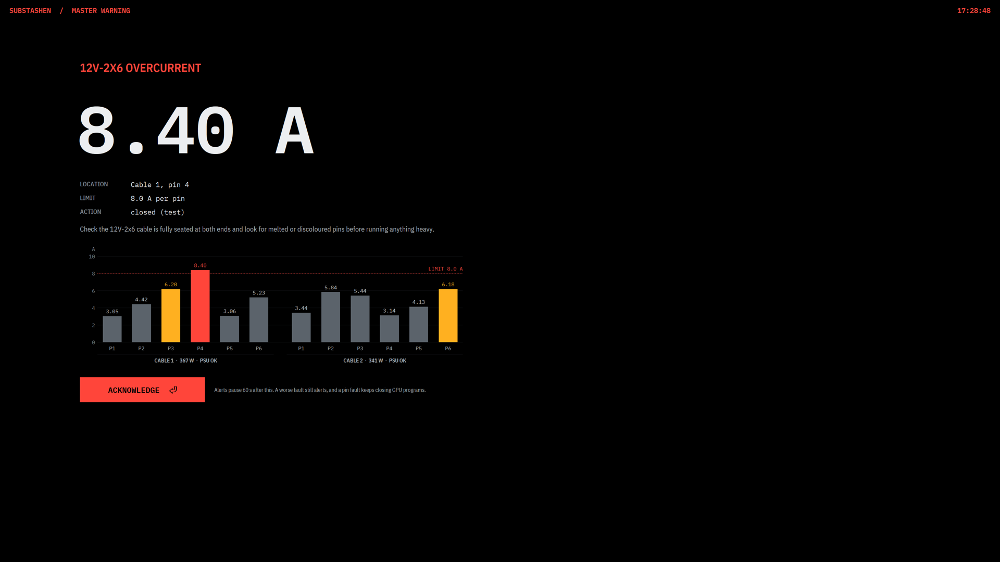
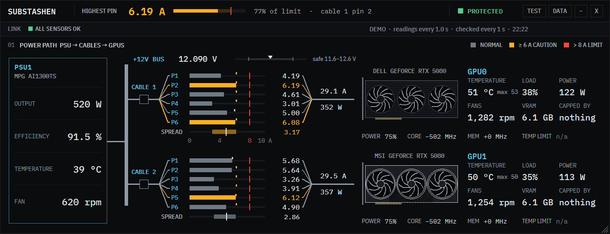
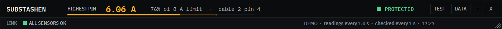
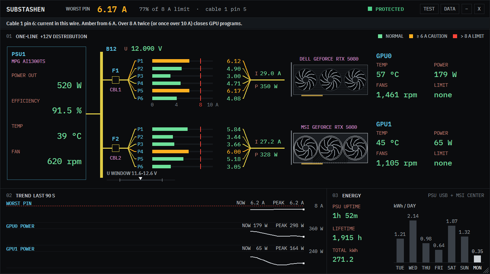
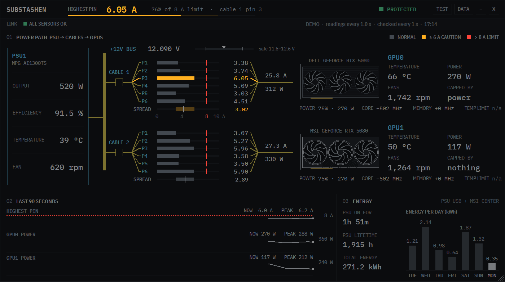

<p align="center">
  
</p>

<h1 align="center">Substashen</h1>

<p align="center">
  <b>Per-pin 12V-2x6 protection for NVIDIA GPUs on Windows.</b><br>
  An always-on-top, substation-style control panel that watches every pin of your GPU power cables
  and shuts GPU load down before a connector can overheat.
</p>

<p align="center">
  
</p>

---

## Why

12VHPWR / 12V-2x6 connectors fail when current stops sharing evenly across their six 12 V pins. One pin
ends up carrying far more than its share, its contact heats, and the connector melts. Normal tools show
board power, which can look perfectly fine while a single pin is overloaded.

Substashen reads **all 12 pin currents** (two cables × six pins) reported by an MSI PCIe 5 power supply.
It warns early, and when a pin goes over its limit it closes the programs using the GPUs and covers
every monitor with an alarm until you acknowledge it.

## What it does

| Condition | Response |
|---|---|
| Any pin **over 8 A** in 2 consecutive samples, or once **over 10 A** | Closes every program using the NVIDIA GPUs, repeats every 3 s while the fault lasts, sounds a warning and covers every monitor |
| The PSU's own **Safeguard+** alarm on a cable | Same as above, immediately |
| PSU **+12 V** outside **11.6–12.6 V** for 3 samples | Warning sound and full-screen alert; nothing is closed |
| One cable's pins **≥ 4 A apart** under load for 5 s | Amber **WARNING** and an entry in the incident log (early sign of a bad connection) |
| A pin carrying **≥ 7 A for minutes** | Amber **WARNING** and an entry in the incident log |
| A card **> 20 W over your power cap** for 30 s | Amber **WARNING** (the cap may have been reset by a driver update) |
| Sensor data missing, stale or frozen | **NOT PROTECTED** shown with the fix; full-screen alert after 30 s |

The warning rules only warn. Only the 8 A rule and the PSU alarm close programs.

<p align="center">
  
</p>

## The panel

- **HIGHEST PIN**: the highest of the 12 currents, how close it is to the 8 A limit, and a headroom bar (caution zone 6–8 A, red tick at the limit) you can read from across the room.
- **Balance strip under each cable**: a band from the cable's lowest to its highest pin. Narrow means the pins share evenly; wide means one pin is doing more than its share. It turns amber at the same point the uneven-current warning fires.
- **Power path diagram**: PSU → +12 V bus (with its safe 11.6–12.6 V range) → cable 1 and cable 2 → six pins each → the card they feed.
  Each pin has its live value and a bar against the 8 A limit. The cable-to-card match is worked out
  automatically from watts.
- **Line drawings of each card** with fans that turn at their real speed, plus temperature, power, fans and what is capping its clock (*CAPPED BY: voltage / power / heat*, which is normal).
- **Afterburner settings under each card**: the power limit (% and watts), core and memory clock offsets and temperature limit Afterburner has applied, read-only from its control memory. *n/a* means the card doesn't expose that setting.
- **LINK row**: shows *ALL SENSORS OK*, or exactly which data source is missing and a button to fix it.
- **Last 90 seconds**: the highest pin and each GPU's power over 90 s, auto-scaled.
- **Energy**: PSU uptime and lifetime hours read from the PSU over USB, plus kWh from MSI Center's record.
- **Hover anything** for a plain-English explanation.

| Standard view | Compact view |
|---|---|
|  |  |

| Hover help | Night dimming |
|---|---|
|  |  |

Colour carries meaning only: labels and normal bars are grey, green means healthy, **amber** means caution or not protected, and **red**
means over a limit. The design follows high-performance HMI practice: calm when healthy, loud when not.

## Requirements

- Windows 11 (tested; Windows 10 should work)
- Python 3.12+ (tested on 3.14), standard library only (Pillow is needed only to rebuild the icon)
- **MSI Afterburner**, running with GPU monitoring and the **MSI PSU** monitoring plugin enabled
  (*Settings → Monitoring*)
- An **MSI PSU with per-pin 12V-2x6 monitoring**. Developed on the **MPG Ai1300TS PCIE5**; other models
  that expose the same sensors through Afterburner should work.
- NVIDIA GPU(s) with `nvidia-smi` (installed with the driver)
- Optional: MSI Center, for the kWh history

No administrator rights are needed.

## Install

1. Put this folder somewhere permanent.
2. Build the small launcher, which gives Windows a proper app name and icon:
   ```bat
   launcher\build.bat
   ```
   It uses the C# compiler that ships with Windows.
3. Double-click **`Install Substashen Autostart.bat`**.
   Substashen appears in *Settings → Apps → Startup* with an on/off toggle, and starts straight away.

To remove it, run **`Remove Substashen Autostart.bat`**.

To run it by hand:
```bat
pythonw substashen.pyw
```

## Using it

| Key / action | Does |
|---|---|
| **TEST** button / `T` | Rings the alarm and shows the alert screen; nothing is closed |
| `C` or double-click the header | Cycles **Full → Standard → Compact** |
| `D` / **DATA** | Every raw reading, plus the latest events |
| `M` / **–** | Minimize to the taskbar (protection keeps running) |
| `N` | Night dimming on/off (automatic 23:00–07:00) |
| `O` | Slightly see-through when the mouse isn't over it |
| Drag | Move it; the corner grip resizes. Position and size are remembered. |

Keys work after you click the panel once.

### Settings (`settings.json`)

| Key | Default | Meaning |
|---|---|---|
| `power_cap_w` | `270` | Your GPU power limit; the power-cap warning triggers 20 W above it |
| `night_hours` | `[23, 7]` | When night dimming is on |
| `gpu_models` | — | Names shown above each card, e.g. `{"MSI": "MSI RTX 5080 VENTUS 3X OC"}` |
| `view`, `zoom`, `pos` | — | Saved automatically |

### Files it writes

- **`incidents.log`**: every alarm, warning, acknowledgement, start/stop and wake from sleep, with all 12 pin
  values at that moment, plus a daily summary (peak pins, time ≥ 6 A, widest spread).
- **`substashen.log`**: internal errors only.

## How it gets the data

```
MSI PSU ──USB──► MSI Afterburner (PSU plugin) ──shared memory──► Substashen ◄── nvidia-smi (closing programs)
   │                                                                ▲
   └──USB, read-only, once a minute: uptime counters ───────────────┘
MSI Center profile file ── kWh history ─────────────────────────────┘
```

- **Live sensors** come from Afterburner's `MAHMSharedMemory`, read in place once a second.
  The sensor layout is cached and re-checked on every read.
- **PSU uptime and lifetime** are read straight from the PSU over USB HID, using only the two read commands
  `51 D0` / `51 D1`. The code refuses to build any other frame, so settings can never be written to the PSU.
  See [`PSU_PROTOCOL.md`](PSU_PROTOCOL.md) for the decoded protocol.
- **Afterburner settings** (power limit, clock offsets, temperature limit) come from Afterburner's
  `MACMSharedMemory`, mapped read-only every 5 s, so Substashen can never change them.
- **Lightweight**: about 0.5% of one CPU core at idle and about 30 MB of private memory. Drawing is
  retained: only changed values are updated, each screen region is repainted on its own, and drawing
  pauses while minimized.

## Testing

```bat
python substashen.pyw --selftest     :: rules, debounce, warning rules, sensor-name mapping, alarm files
python substashen.pyw --demo         :: fake data, safe to click around
python substashen.pyw --demo-fault   :: fake 8.4 A pin: shows the alert (demo never closes programs)
```

## Limits and safety

- This is a **software monitor**. It complements, and does not replace, a correctly seated cable and the
  PSU's own protection. On the Ai1300TS, GPU Safeguard+ cuts power in hardware.
- It can't close programs running as administrator or protected by kernel anti-cheat. The alert then
  says **COULD NOT CLOSE** so you can act yourself.
- It only protects while it's running and Afterburner is supplying data. The LINK row and the
  *protection offline* alert tell you when that isn't the case.
- Warning thresholds are starting points. Tune them against your own `incidents.log`.

## Credits

- Fonts: [IBM Plex Mono and IBM Plex Sans Condensed](https://github.com/IBM/plex) (SIL Open Font License,
  bundled in `fonts/`)
- PSU protocol cross-checked against [MeltAlarm](https://github.com/DeniDoman/meltalarm),
  [RTXLens](https://github.com/Codeh4ck/RTXLens) and [msi-psu-monitor](https://github.com/boboom66/msi-psu-monitor)

Not affiliated with MSI, NVIDIA or Dell.
